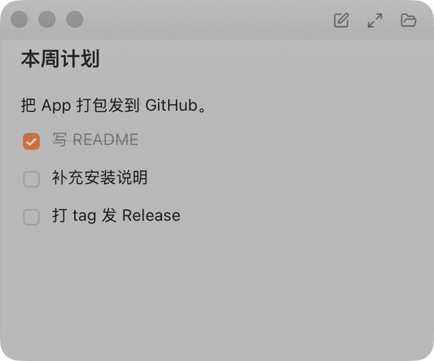
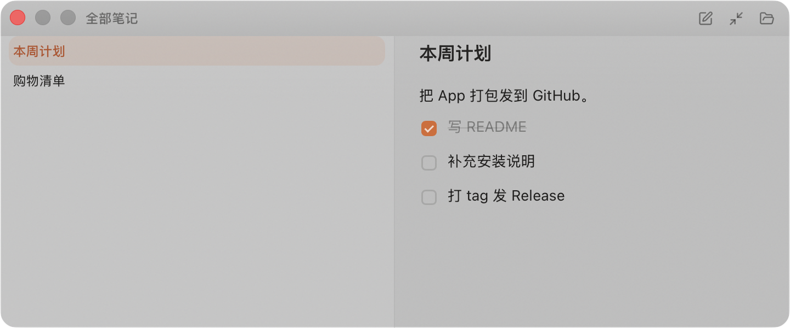

# 小记事本 · Mininote

> 一块贴在桌面右上角的玻璃便签。⌘⇧Space 一按即现即写，写完就走。

   





---

## 特色

**轻到几乎不存在。** 菜单栏常驻，没有 Dock 图标，不占 ⌘Tab。小窗只有 360×300，不到 14 寸屏的八分之一，安静地蹲在屏幕右上角贴着菜单栏。

**一按即现即写。** 全局快捷键 `⌘⇧Space`，**同一个键开、关**。新建笔记时光标直接落在标题上，写完标题按回车就进正文 —— 不用鼠标。

**写完就走。** 400ms 防抖自动保存，落盘是原子的（先写临时文件再改名），写到一半断电也不会留下半个文件。

**数据是自己的。** 每条笔记就是一个纯 Markdown 文件，带 YAML frontmatter，躺在 `~/Documents/备忘录/`。删掉 App 笔记还在；用别的编辑器改了文件，App 会自动感知。

**玻璃是系统给的。** macOS 的 Liquid Glass 原生材质，不是 CSS 画出来的假玻璃。

**安静。** 320ms 的窗口形变跟手不喧哗；跟随系统的亮/暗主题；尊重「减弱动画」「减弱透明度」的系统偏好。

---

## 已实现的功能

### 窗口与外壳

- 菜单栏托盘常驻（**无 Dock 图标**），托盘菜单：显示/隐藏小窗、打开笔记目录、退出
- 全局快捷键 `⌘⇧Space` —— 同一个键开/关
- 小窗 360×300，默认停在**屏幕右上角**（右侧留 10pt，正好在菜单栏下方）
- 一键展开成 720×300 的「笔记列表 + 笔记」双栏视图：宽度**向左生长**、右边缘锚定，笔记本身纹丝不动；收回时精确还原到原位
- 关掉窗口只是隐藏，进程、托盘图标和快捷键都还在
- **启动就把小窗显示出来**；应用已在运行时再双击一次 `.app`，窗口也会被叫出来

### 编辑

- 所见即所得编辑器：粗体 / 斜体 / 删除线 / 行内代码 / 代码块 / 标题 1–3 / 有序无序列表 / 任务清单 / 引用 / 分隔线 / 链接
- 选中文字时浮出格式工具条
- 标题独立于正文（存在 frontmatter 里）；新建笔记后光标落在标题，回车进正文
- 任务清单的 `- [ ]` / `- [x]` 存成 Markdown 再读回来，一字不差

### 保存与数据

- 自动保存（400ms 防抖）；**没编辑过的文件绝不重写**
- 原子写：先写 `.tmp` 再 `rename` 覆盖
- 外部改动监听：用别的编辑器改了 `.md`，App 自动刷新
- 冲突保护：磁盘上的版本和载入时对不上就**拒绝覆盖**，顶部提示「文件已被外部修改」—— 绝不默默吃掉你打的字

### 界面

- 亮/暗主题跟随系统
- 尊重 `prefers-reduced-motion` 与 `prefers-reduced-transparency`（系统开了「减弱透明度」就降级成实色面板）
- 展开态侧栏列出全部笔记，当前笔记高亮

---

## 安装

### 下载现成的（推荐）

1. 打开 [Releases](https://github.com/Wang-Qiulu/mininote/releases) 页面，下载 `mininote-v0.1.0-macos.zip`（里面是「小记事本.app」）
2. 解压，把 **小记事本.app** 拖进「应用程序」文件夹
3. 第一次打开：右键点它 → 选「打开」→ 再点「打开」
   （没做开发者签名，Gatekeeper 会拦一下。命令行放行：`xattr -dr com.apple.quarantine "/Applications/小记事本.app"`）
4. 启动后小窗会**直接出现在屏幕右上角**。之后它就常驻菜单栏了：

   

   这个图标就是入口 —— 点它，菜单里有「显示/隐藏小窗」「打开笔记目录」「退出」。

   **没有 Dock 图标是正常的**：这是菜单栏应用，不占 ⌘Tab、不抢任务栏，图标挤在电量、Wi‑Fi 那一堆状态图标里。
5. 随时按 `⌘⇧Space` 唤出／收起小窗（**同一个键**）。
6. 第一次按快捷键如果没反应：系统设置 → 隐私与安全性 → 辅助功能 → 加上「小记事本」。
   macOS 的全局快捷键需要这个权限；不给的话系统会**静默丢弃**快捷键，不报错也不弹窗。

**要求：macOS 13 或更高。** macOS 26 及以上会自动换上 Liquid Glass 材质，低版本也有优雅降级。

### 从源码构建

需要 macOS 13+、Node.js 20+、Rust 1.77+、Xcode Command Line Tools。

```bash
git clone https://github.com/Wang-Qiulu/mininote.git
cd mininote
npm install

npm run app          # 开发模式（Vite 热更新 + Rust，改代码立刻见效）
npm run app:build    # 打包出 .app
```

产物在 `src-tauri/target/release/bundle/macos/小记事本.app`。

---

## 笔记存在哪

默认 `~/Documents/备忘录/`，每条笔记一个文件：

```markdown
---
title: 周会纪要
created: 2026-11-02T14:20:00
updated: 2026-11-03T15:05:00
pinned: false
due: 2026-11-05
done: false
---

讨论了下季度路线图……

- [x] 拉通数据口径
- [ ] 出设计稿
```

文件是唯一真相源：删掉 App，数据还在；用别的编辑器改，App 会自动刷新，并且不会用旧内容覆盖你的新内容。

---

<!-- 下面开始是技术内容 -->

---

## 技术

### 技术栈

| 层 | 选型 | 为什么 |
| --- | --- | --- |
| 外壳 | Tauri 2.12（Rust） | 体积小（.app 只有 3.9 MiB）、能直接用系统的窗口材质和全局快捷键 |
| 前端 | React 19 + TypeScript 5.9 + Vite 8 | — |
| 编辑器 | TipTap 3.32 + `@tiptap/markdown` | 所见即所得，且能原样吐 Markdown |
| 状态 | zustand | 够用，体积小 |
| 动效 | 纯 CSS | 弹簧用 `cubic-bezier` 近似，省一个依赖、启动更快 |
| 文件监听 | notify 8 | — |

### 目录结构

```text
mininote/
├── src/                       前端
│   ├── App.tsx                外壳：模式切换、事件监听
│   ├── components/EditorPane.tsx  所见即所得编辑器、标题、自动保存
│   ├── store/appStore.ts      zustand
│   ├── lib/{api,time}.ts      IPC 封装、时间与到期计算
│   └── styles/{tokens,global}.css  设计令牌与玻璃样式
├── src-tauri/src/
│   ├── notes.rs               存储层：frontmatter 解析、原子写、CRUD（9 个单测）
│   ├── window.rs              显隐、定位、形变动画
│   ├── lib.rs                 生命周期、命令、快捷键、托盘接线
│   ├── tray.rs                菜单栏图标与菜单
│   └── watcher.rs             外部文件变更监听
├── scripts/
│   ├── gen-icons.mjs          图标生成（纯 Node，无依赖）
│   ├── roundtrip-test.mjs     Markdown 往返幂等测试（14 个用例）
│   ├── escape-accumulation-test.mjs  转义累积测试（8 个用例）
│   └── shot-window.py         只截本应用窗口的截图脚本
└── docs/                      README 用的截图
```

### 几个关键实现

**玻璃交给系统。** Tauri 2.12 原生支持 macOS 26 的 `liquidGlassRegular`，CSS 只在系统材质之上叠加渐变描边、内高光和噪点。WKWebView 的 `backdrop-filter` **模糊不到桌面**（backdrop 只含自身绘制内容），所以不做那种假折射。

**动画在 Rust 侧驱动。** Tauri 的**同步命令跑在主线程上**，320ms 的动画会把窗口合成堵死，前端只会看到卡顿。所以 `set_window_mode` 立刻返回，动画派到独立线程，用真实时间算弹簧值、固定 60fps 步进。

**右边缘锚定。** `tao` 的 `setContentSize` 锚的是 NSWindow 的**左下角**，不是左上角 —— 直接用会让窗口飘。所以每帧同时下发尺寸和位置，收回时按展开前记录的锚点精确还原。

**存 Markdown 是有损的，只承诺一部分无损。** 粗体 / 斜体 / 删除线 / 行内代码 / 代码块 / 标题 / 列表 / 任务清单 / 引用 / 分隔线这一组往返无损；普通文本里的 `_` `[]` `~` 会在**第一次保存**时被转义（语义一致，且只变一次不再累积）。为此写了两个脚本实测：14 个往返用例 + 8 个转义累积用例，全部幂等。

**未编辑过的文件绝不重写。** 判断依据是**和磁盘上的内容比对**，不是时序敏感的抑制标志位 —— 载入时哪怕 `onUpdate` 延迟触发，也不可能把没改过的文件重写一遍。

**写盘带冲突检测。** 落盘时把载入时的正文作为「期望版本」一起传给后端；磁盘上的内容若已经和它不一致，后端直接拒绝写入，前端显示冲突提示。

**托盘应用的坑。** 打包后的 `.app` 里 Tauri 的 bundler 不会写 `LSUIElement`（[tauri#15005](https://github.com/tauri-apps/tauri/issues/15005)），托盘应用会重新冒出 Dock 图标 —— 所以自带 `Info.plist` 显式声明，和运行时的 `set_activation_policy(Accessory)` 互为保险。

### 开发与测试

```bash
npm run build              # 类型检查 + 打包
npm run app                # 开发模式
npm run app:build          # 打包 .app

cd src-tauri && cargo test # Rust 单元测试（9 个）
npm run test:roundtrip     # Markdown 往返幂等
npm run test:escape        # 转义不累积
```

### 路线图

- [x] **P0** 窗口外壳、菜单栏托盘、形变动画
- [x] **P1** 存储层：frontmatter 解析、原子写、外部改动监听、冲突检测
- [x] **P2** 所见即所得编辑器（TipTap 3）、自动保存
- [ ] **P3** 大窗列表：置顶 + 时间分组、玻璃卡片、待办进度与到期提醒、永久删除
- [ ] **P4** 设置项、命令面板、主题手选、字号调节、记住窗口位置

第一版刻意不做：全文搜索、标签、云同步、移动端、系统通知。

## 许可证

[MIT](LICENSE)
